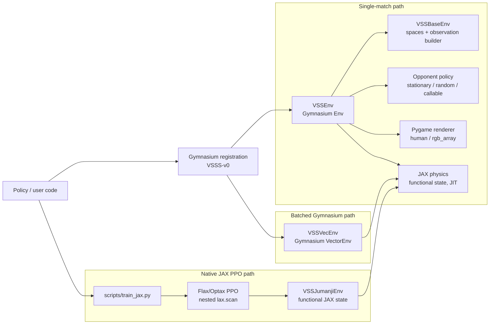
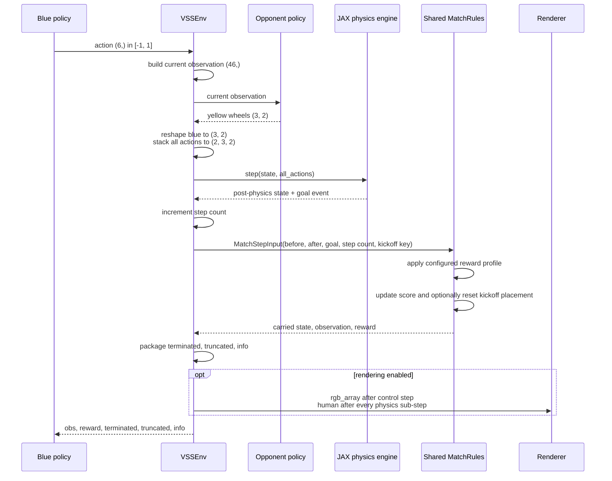
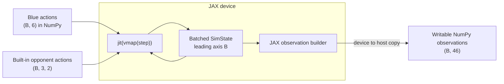
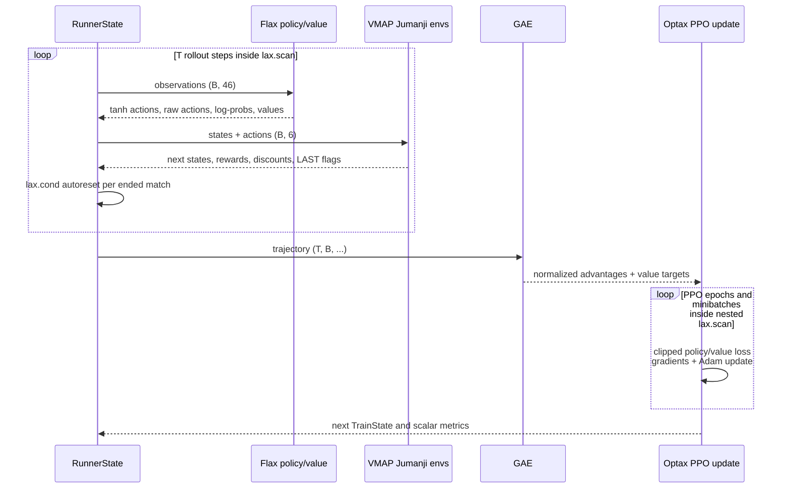
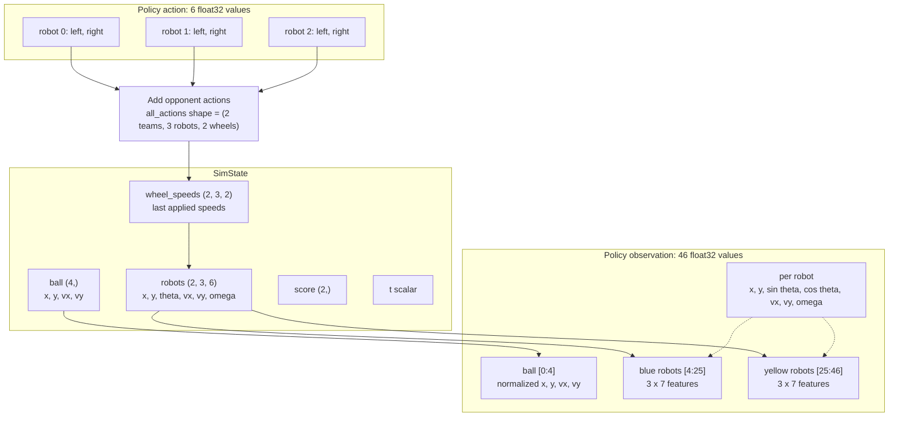
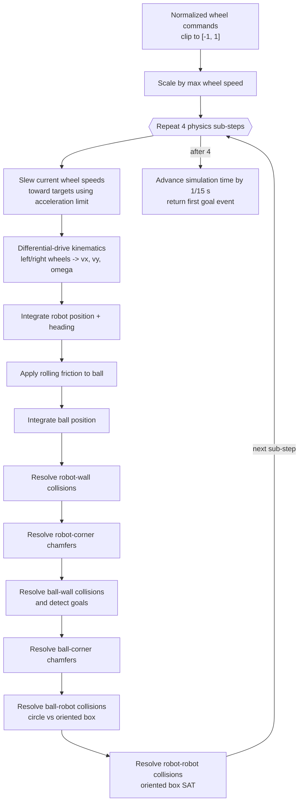
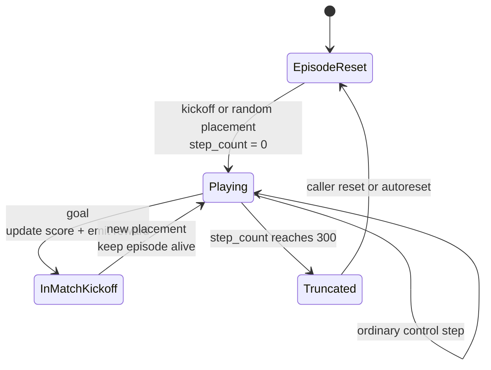
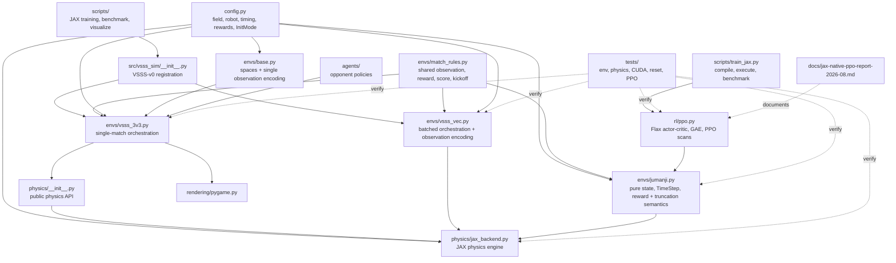

# Simulator structure

This document is a visual map of the simulator as it exists today. Read it top-to-bottom
for progressively more detail: public entry points, one environment step, the Gymnasium vector
interface, native PPO data flow, data shapes, physics, and reset semantics.

> This is **IEEE VSSS 3v3**: six differential-drive robots, two wheel commands per robot,
> no kicker or dribbler, and a walled 150 x 130 cm field.

## 1. System map

The simulator provides Gymnasium single-match and batched interfaces for interactive use and
external clients, plus a fully JAX-native PPO path for training. All three use the same JAX
physics implementation; native PPO runs the policy, environment, rollout, and optimizer on device.

`VSSEnv` provides rendering and Python opponent callables. `VSSVecEnv` batches physics with
`vmap` and exposes the standard Gymnasium VectorEnv interface, including NumPy observations.
`VSSJumanjiEnv` represents a pure match; PPO batches it with `vmap` and keeps policy, rollout,
GAE, gradients, and optimizer state on the JAX device.

## 2. One control step in `VSSEnv`

The controlled policy only commands blue. The environment obtains yellow's commands from the
configured opponent, combines both teams, advances physics, and delegates reward, score, kickoff,
and observation semantics to the shared `MatchRules` module.

`terminated` is always false: a match has no absorbing mid-episode state. The time limit sets
`truncated`; goals update the score and trigger a kickoff without ending the episode.

## 3. Batched Gymnasium path

`VSSVecEnv` keeps the batched simulation state on the JAX device and exposes observations and
step results through Gymnasium's VectorEnv contract. This interface is useful for rendering-
adjacent tooling and external clients that consume Gymnasium directly. Native PPO uses
`VSSJumanjiEnv` instead, avoiding per-step host transfers while keeping the same match rules.

Stationary and random opponents are assembled as batches. A custom callable receives one
observation at a time through a Python loop, so it is intended for development rather than
maximum training throughput. Gymnasium vector mode uses next-step autoreset after truncation.

## 4. One fully compiled PPO generation

With the defaults, one generation collects `B x T = 256 x 128 = 32768` transitions and then
performs four PPO epochs over eight minibatches. The shapes remain static, allowing XLA to
compile the entire sequence.

Time-limit truncation has two signals: `discount=1` bootstraps the value from the final
observation, while `LAST` stops GAE recursion before the reset episode. Goals are not terminal;
they update the score and trigger an in-match kickoff.

## 5. Data model and RL interface

The physics state is richer than the policy observation. Wheel speeds, score, and time remain
internal; positions and velocities are normalized into one flat policy vector.

For `VSSVecEnv`, every state and interface shape above gains a leading batch dimension `B`.
For native PPO, `jax.vmap` adds that dimension to `VSSJumanjiEnv.State`, while `lax.scan` adds
the rollout dimension `T` to stored transitions.

## 6. Physics step: 15 Hz control, 4 sub-steps

A policy selects target wheel speeds once per 1/15-second control step. The physics engine
splits that interval into four smaller steps for smoother acceleration and more reliable
collision handling.

State is an immutable float32 `NamedTuple` PyTree. `step` returns a new state, uses
`lax.fori_loop` for substeps, and can be transformed directly with `jax.jit` and `jax.vmap`.

## 7. Match and reset lifecycle

There are two different resets: a goal creates a new kickoff *inside* the same match, while the
time limit ends the episode and causes a full reset.

`InitMode.KICKOFF` uses the standard formation with jitter. `InitMode.RANDOM` samples the ball
and all robots across the field with random headings; overlaps are allowed and left for physics
to resolve.

### Current implementation boundaries

These details matter when comparing trajectories across execution paths:

- `VSSEnv` supports rendering; `VSSVecEnv` currently does not.
- Human rendering advances and draws each physics sub-step. Non-human stepping runs one engine
  call for the whole control step.
- A goal kickoff creates fresh placement but preserves match score and simulation time in all
  environment adapters. Episode step counts continue through in-match kickoffs.
- Shared `MatchRules` computes reward from the post-physics state before kickoff, then returns an
  observation of the state carried forward after any kickoff. Single, vector, and Jumanji paths
  use this same ordering.
- Physics resolves the field's 45-degree corner chamfers for both robots and the ball.
- `VSSVecEnv` uses Gymnasium next-step autoreset after truncation.
- `VSSJumanjiEnv` is functional and renderer-free. Its built-in stationary and random opponents
  stay in JAX; arbitrary Python opponent callables are intentionally unsupported in this path.
- Native PPO autoresets ended episodes through `lax.cond` and bootstraps timeout values from the
  final observation before replacing it with the reset observation.

## 8. Source map

